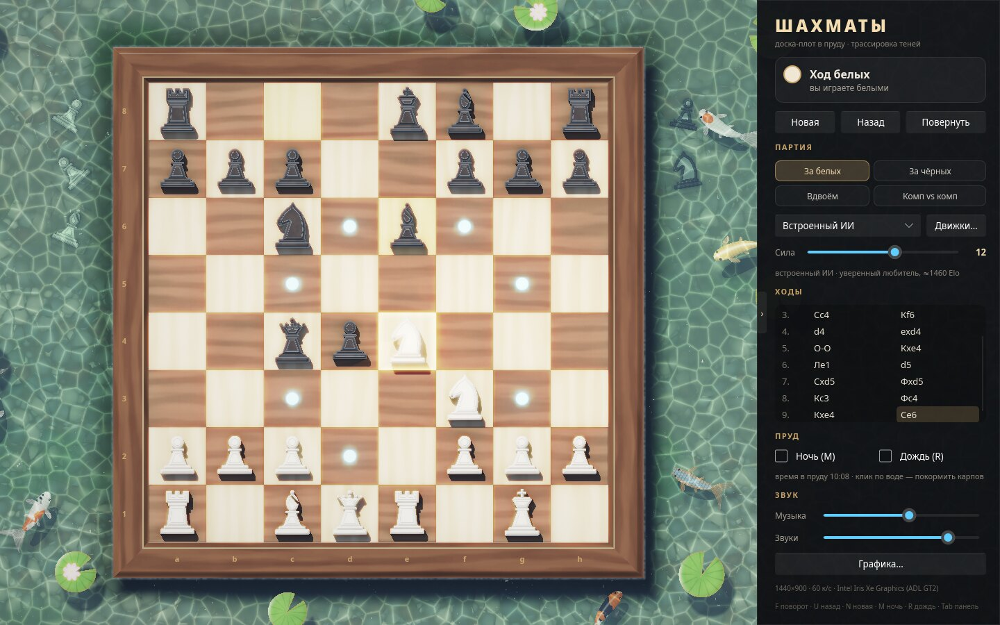
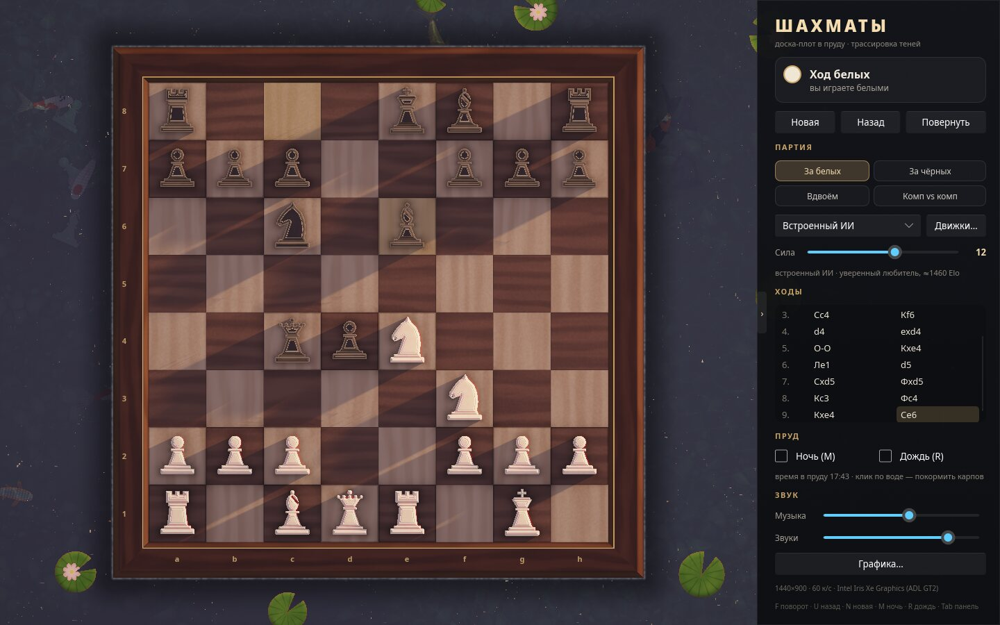
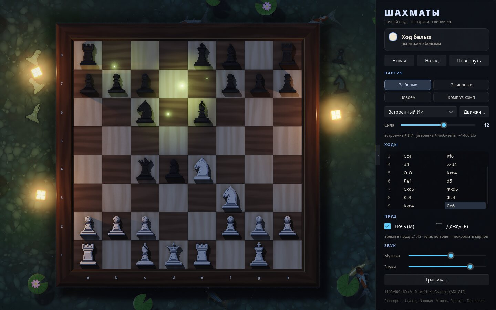
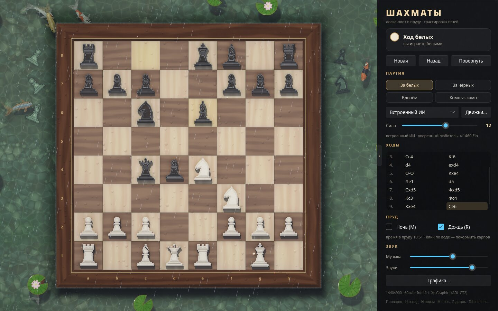
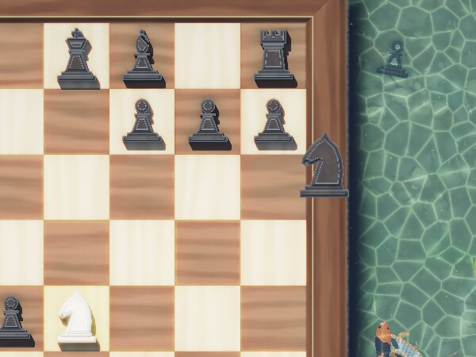
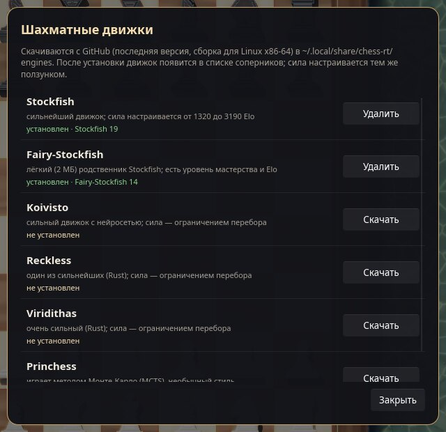

<h1 align="center">chess-rt</h1>

<p align="center">
  <b>Chess on a wooden raft in a koi pond.</b><br>
  A 2D chess game where the whole scene is one fragment shader under a Slint UI:
  ray-traced soft shadows, water with caustics, koi, lanterns at night, rain and lightning.
</p>

<p align="center">
  
  
  
  
  
  
</p>

<p align="center">
  
</p>

The board is a raft. Pieces are ivory and ebony relief tokens that cast real shadows, the water around it refracts the
pebbles on the bottom, light focuses into moving caustics, and six koi wander about, casting their own shadows on the bed.
Click the water and they come to eat. When a piece is captured it flies off the board, splashes into the pond and sinks;
the pieces each side has lost stay on the bottom, white ones on the left, black ones on the right.

<table>
  <tr>
    <td width="33%"></td>
    <td width="33%"></td>
    <td width="33%"></td>
  </tr>
  <tr>
    <td align="center">golden hour</td>
    <td align="center">night: lanterns and fireflies</td>
    <td align="center">rain</td>
  </tr>
</table>

## What is in it

**The picture.** Everything below the panel is drawn by `shaders/scene.frag`; there are no textures or sprites.

- Pieces are 2D signed-distance silhouettes extruded into bevelled relief. Every pixel traces soft shadows towards
  each light by sphere-tracing the pieces as prisms: the sun or moon, three floating lanterns, the glow under a
  selected piece, the red light of a king in check, and lightning.
- Water: refraction, absorption that turns it green with depth, animated caustics on the pebbles, ripples from food,
  fish and splashes, rain rings, sky and cloud reflections, sun glitter.
- Koi with a real body profile, a swimming wave down the spine, a body that bends when they turn, translucent forked
  tails and flapping fins, six varieties (kohaku, ogon, showa, tancho, asagi, sanke), each at its own depth.
- A day cycle (optional): sunrise, a high noon sun, a golden sunset with long shadows, then moon, lanterns and
  fireflies. Or switch day and night by hand. Rain makes everything wet; at night it brings lightning.
- Bloom from the HDR mip chain and ACES tone mapping. Static layers (wood, pebbles) are baked once per window size.

<p align="center">
  
</p>

**The game.** Full rules (castling, en passant, promotion, check, mate, stalemate, the 50-move rule, threefold
repetition, insufficient material), moves by click or drag and drop, undo, board flip, and the move list in Russian
notation. Play white or black against the computer, two players on one board, or watch computer against computer.

**The built-in engine** is an alpha-beta search with a transposition table, quiescence search, null-move pruning and
late-move reductions. Its strength is a slider from 1 to 20. The lower levels look three moves ahead and pick
moves the way a weaker player would (a softmax over move scores, with an occasional blunder at the very bottom);
the upper levels search deeper and then by time. The steps were tuned with headless self-play matches and anchored
against Stockfish with limited strength:

| level | 1 | 6 | 12 | 17 | 20 |
|---|---|---|---|---|---|
| ≈ Elo (Stockfish `UCI_Elo` scale) | 550 | 1150 | 1460 | 1660 | 2100 |

**Downloadable engines.** The «Движки…» dialog installs UCI engines straight from their latest GitHub releases (Linux
x86-64 builds): Stockfish, Fairy-Stockfish, Koivisto, Reckless, Viridithas and Princhess. An installed engine shows up
as an opponent, and the same slider sets its strength: through `UCI_Elo` where the engine has it (Stockfish
1320–3190, Fairy-Stockfish 500–2850), otherwise through its skill level or a node limit. Level 20 is full strength.

<p align="center">
  
</p>

**Sound.** Generative music for the pond: koto plucks, soft pads and bass in a Japanese pentatonic scale by day, a
darker scale with a slow flute at night, and water drops that thicken in the rain. Effects are soft and tonal: a
wooden knock for a move, a splash and bubbles for a capture, a low bell for check. Everything is synthesized; it plays
through PulseAudio / PipeWire.

## Build and run

You need Rust, a GPU with OpenGL ES 3.0 (any recent Intel, AMD or NVIDIA), and PulseAudio or PipeWire. Downloading
engines uses `curl`, `tar` and `unzip`.

```sh
git clone https://github.com/TheSiriuss/chess-rt
cd chess-rt
cargo run --release
```

On Arch-based systems the build needs `libpulse`; on Debian or Ubuntu, `libpulse-dev`.

Settings are kept in `~/.config/chess-rt/settings.txt`, engines go to `~/.local/share/chess-rt/engines/`.

## Controls

| | |
|---|---|
| click or drag | move a piece; right click drops the selection |
| click the water | feed the koi |
| <kbd>F</kbd> | flip the board |
| <kbd>U</kbd> or <kbd>Ctrl</kbd>+<kbd>Z</kbd> | take back a move |
| <kbd>N</kbd> | new game |
| <kbd>M</kbd> | night / day (with the day cycle on: skip to the next dusk or dawn) |
| <kbd>R</kbd> | rain |
| <kbd>Tab</kbd> | hide the panel |

Shadows, ambient occlusion, bloom, highlights, shadow softness, render resolution and the day cycle are under
«Графика…».

## Command line

```sh
chess-rt --match 12 stockfish@5 40   # 40 headless games: built-in level 12 vs Stockfish at level 5
chess-rt --match d3t60 d3t35 40      # custom built-in settings: depth 3, temperature 60 vs 35
chess-rt --install stockfish         # download and check an engine without the UI
chess-rt --wav pond.wav 60 1 0       # render 60 s of night music with every sound effect
```

## Performance

On an Intel Iris Xe (i5-12500H) at 1920×1145 with every effect on, a frame takes about 18 ms by day, 21 ms in the
rain and 24–26 ms at sunset and at night (low lights mean long shadow rays). The pond animates at about 33 frames per second and moves on the board at full rate. If it runs hot,
set the resolution to 75%.

## Thanks

- The 2D distance functions (trapezoid, ellipse, polygon) follow [Inigo Quilez](https://iquilezles.org/articles/distfunctions2d/).
- The piece-square tables come from Tomasz Michniewski's
  [Simplified Evaluation Function](https://www.chessprogramming.org/Simplified_Evaluation_Function).
- The reverb uses the classic Freeverb delay lengths by Jezar at Dreampoint.
- The downloadable engines are separate programs under their own licenses; chess-rt only fetches the official
  release builds from their GitHub pages and talks to them over UCI.

## License

[WTFPL](http://www.wtfpl.net/): do what you want. See [LICENSE](LICENSE).
